<p align="center">
  <a href="docs/reports/screenshots/README.md">
    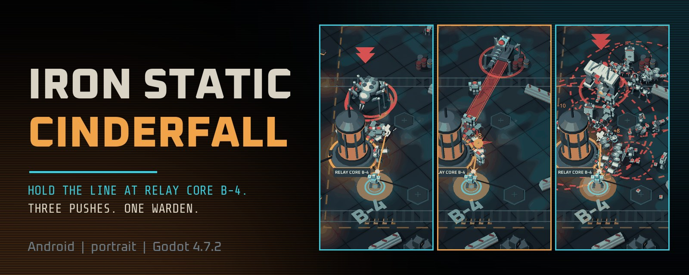
  </a>
</p>

<p align="center"><b>Hold the line at Relay Core B-4. Three pushes. One Warden.</b></p>

<p align="center">
  An original portrait 3D top-down defense game for Android, built with Godot 4.7.2.
  The sequel to <a href="https://github.com/paimonsoror/iron-static">Iron Static</a>.
</p>

<p align="center">
  <a href="docs/reports/screenshots/README.md"><b>Screenshots</b></a> ·
  <a href="docs/design/VARIETY_PITCH.md">The pitch</a> ·
  <a href="docs/GAME_DESIGN.md">Game design</a> ·
  <a href="docs/design/VARIETY_SPEC.md">Variety spec</a> ·
  <a href="docs/ARCHITECTURE.md">Architecture</a> ·
  <a href="docs/WORK_PLAN.md">Work plan</a>
</p>

<p align="center">
  
  
  
  
  
</p>

## Start here

| If you want to | Go here |
|---|---|
| See what the game looks like | [Screenshots](#what-it-is) below, or the [full set with notes](docs/reports/screenshots/README.md) |
| Learn how a run plays | [The pitch](docs/design/VARIETY_PITCH.md) (one run, beat by beat) and [Game design](docs/GAME_DESIGN.md) |
| Know what works today and what is next | [Status](#status) below and the [work plan](docs/WORK_PLAN.md) |
| Build it and run it on a phone | [Quick start](#quick-start) below, then the [build instructions](docs/reports/BUILD_INSTRUCTIONS.md) |
| Understand the code | [Architecture](docs/ARCHITECTURE.md) (contracts, layers, the deterministic sim) |
| Read the design documents | [`docs/design/`](docs/design/VARIETY_SPEC.md) (the spec and every id and number in the content tables) |
| Work on it with a coding agent | [`CLAUDE.md`](CLAUDE.md) (rules, commands, layering, gotchas) |

## What it is

You are **Warden ASH-12**, a lone frame holding **Relay Core B-4** against CHORUS machines. The Warden aims, fires and reloads on its own: you never aim and never move. You choose. Between waves a support cell offers three directives and you keep one, then you pick which of two threats comes next, and weapons are salvage you have to hold the yard to collect. During a wave you swap between two carried weapons, time three abilities and the calls, and watch the swarm build. A run is **three pushes of five waves** (the yard, the gantry line, the node) with a boss at the end of each, and no two runs go the same way. The look is a gritty, rain-wet rail yard lit by amber core light and red machine optics.

| | | | |
|:-:|:-:|:-:|:-:|
| 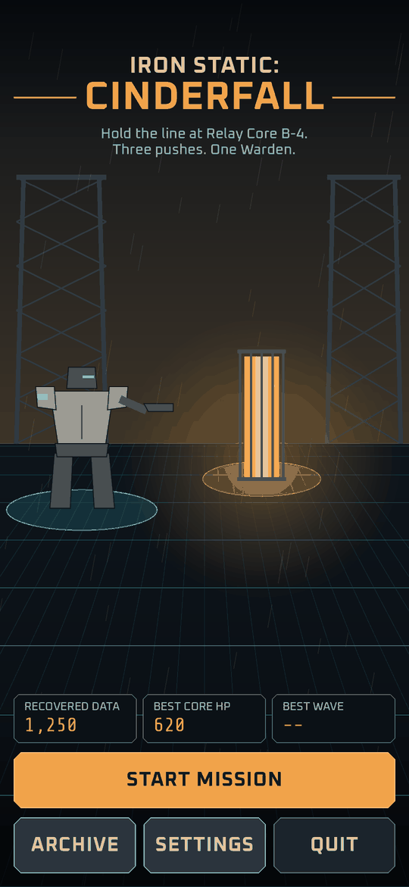 | 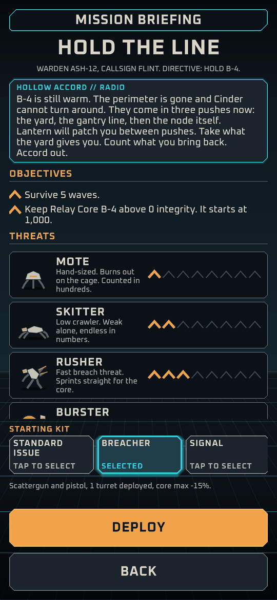 | 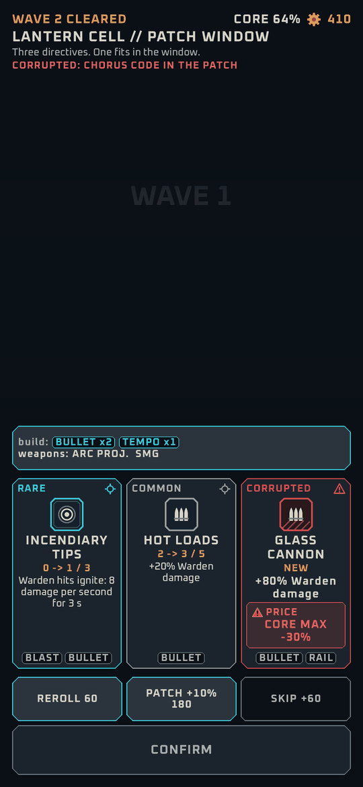 | 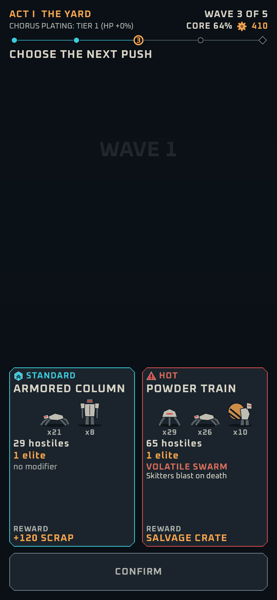 |
| Main menu | Briefing, with the kit row | Draft: keep one of three directives | Route: choose the next threat |
| 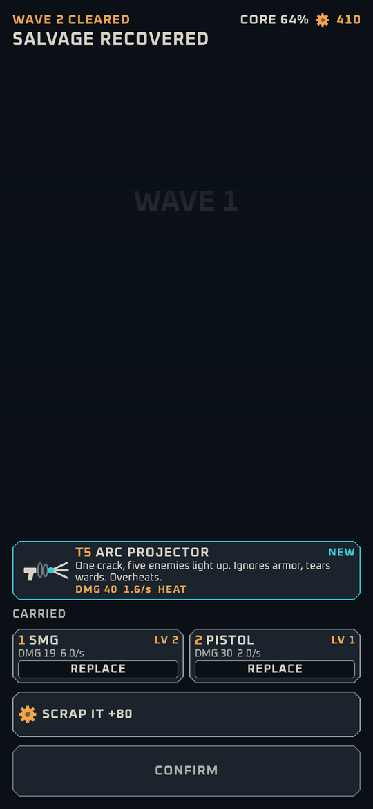 | 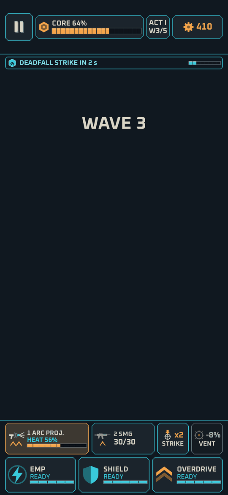 | 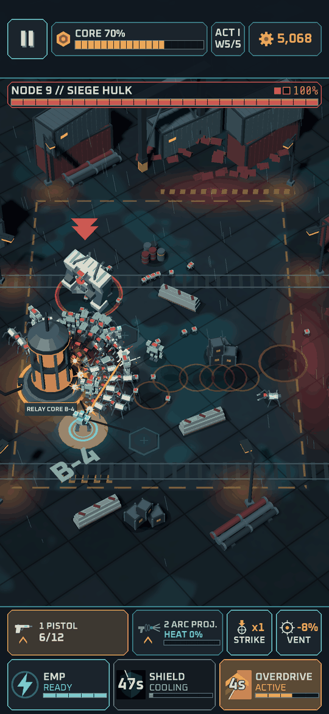 | 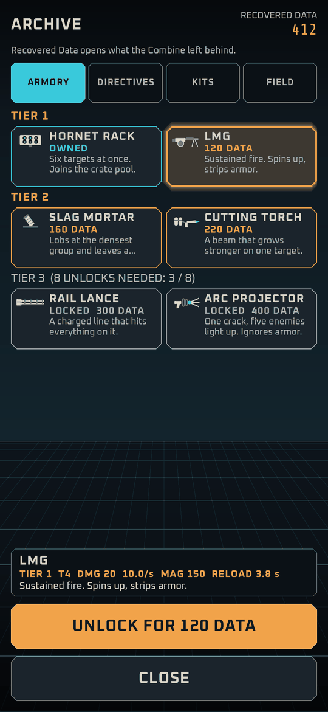 |
| Salvage: a weapon crate | The combat HUD, two weapons | 50 + 40 machines at the cage (HIGH tier) | The Archive: spend Recovered Data |

<sub>Captures of the current build, rendered on a desktop with the real Mobile / Vulkan renderer at 1080x2342 (the outer display of the test phone) and halved. Menu and overlay screens are sandbox scenes with test profiles. The crowd, boss and event pictures are debug scenarios played by a scripted puppet, so the act and wave counter in the top bar is the sandbox's, not a real run. How every picture was made, with a pass or issue note for each: [`docs/reports/screenshots/README.md`](docs/reports/screenshots/README.md).</sub>

**Five bosses and three Hulk variants**, each with its own telegraph and its own answer, announced in a briefing before the wave:

| | | | |
|:-:|:-:|:-:|:-:|
| 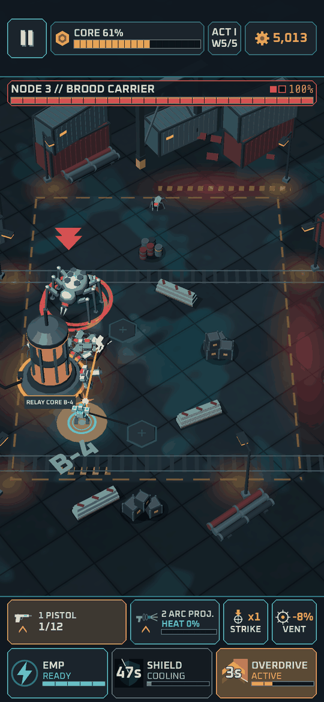 | 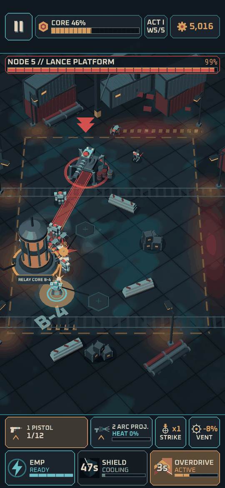 | 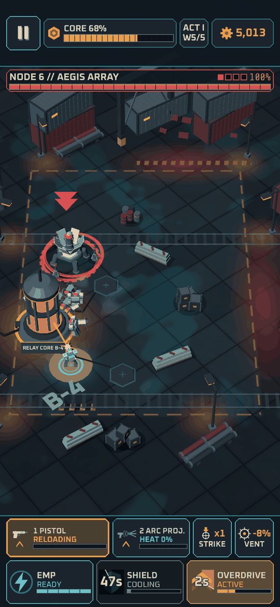 | 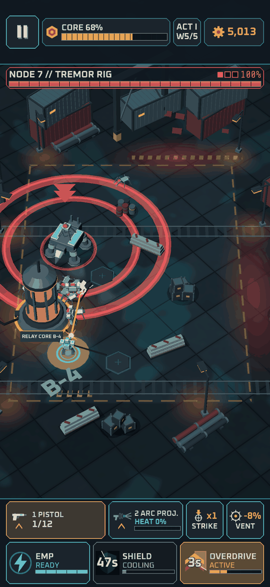 |
| Node 3, Brood Carrier | Node 5, Lance Platform | Node 6, Aegis Array | Node 7, Tremor Rig |
| 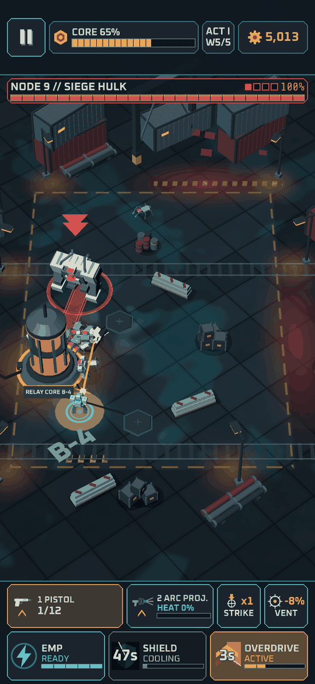 | 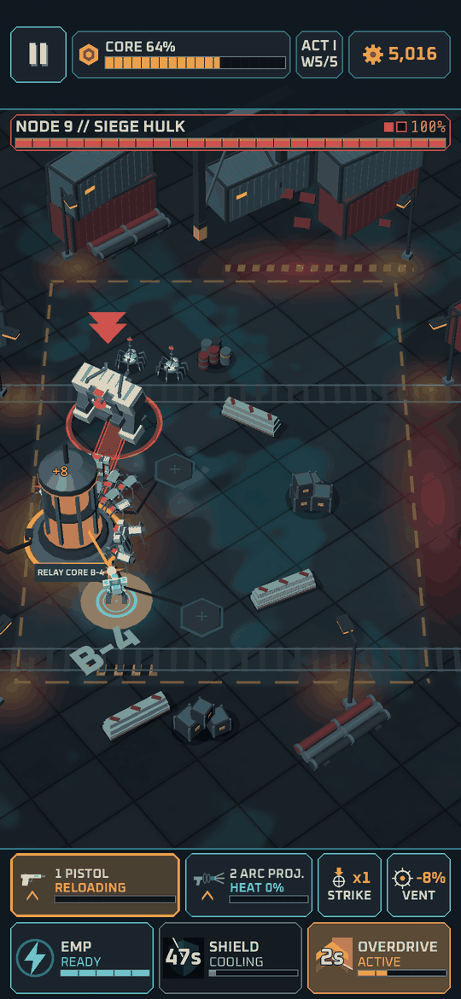 |  | 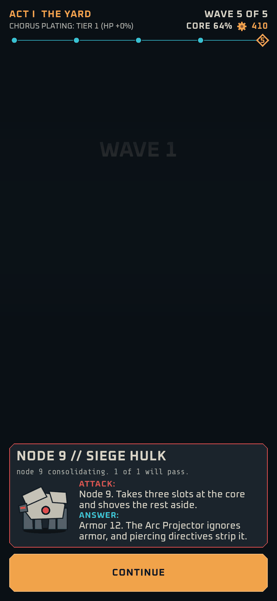 |
| Node 9, plated | Node 9, fed | Node 9, overclocked | The boss briefing |

**The yard misbehaves, and the screen stays readable.** Ten chaos events warn before they land (a ticker line, a ground telegraph and an edge arrow), the quality tiers change effects and never the simulation, and Reduced Flash and High Contrast are complete:

| | | | |
|:-:|:-:|:-:|:-:|
| 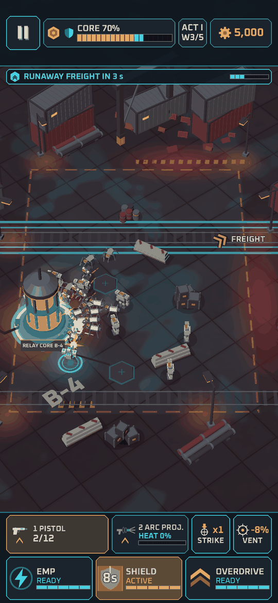 | 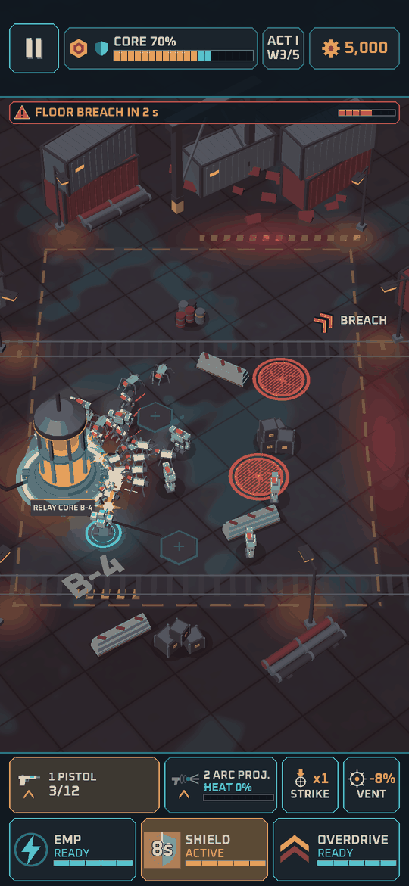 | 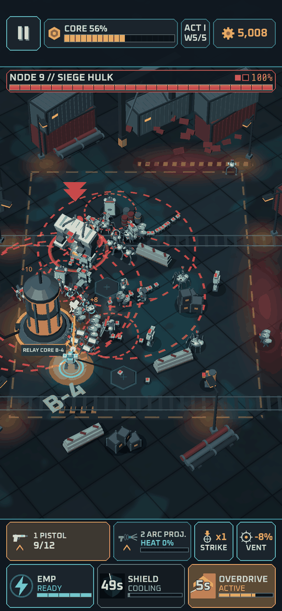 | 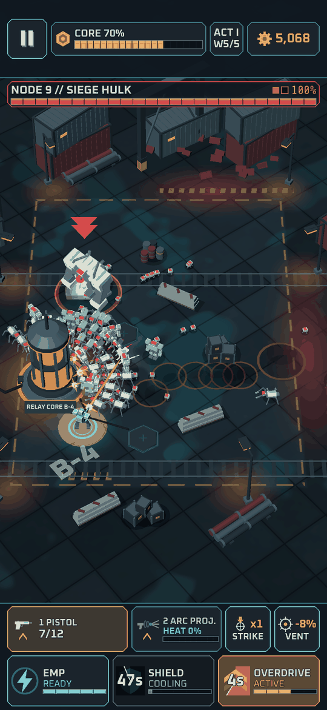 |
| Runaway Freight | Floor Breach | Ten enemy types in one crowd | High Contrast |
| 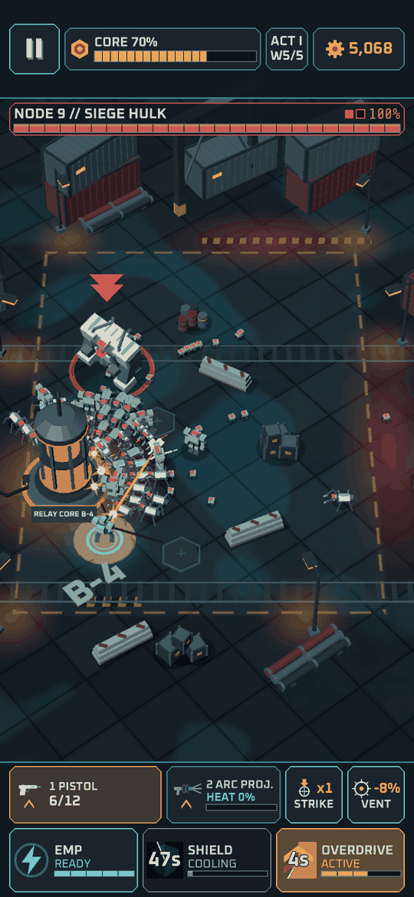 | 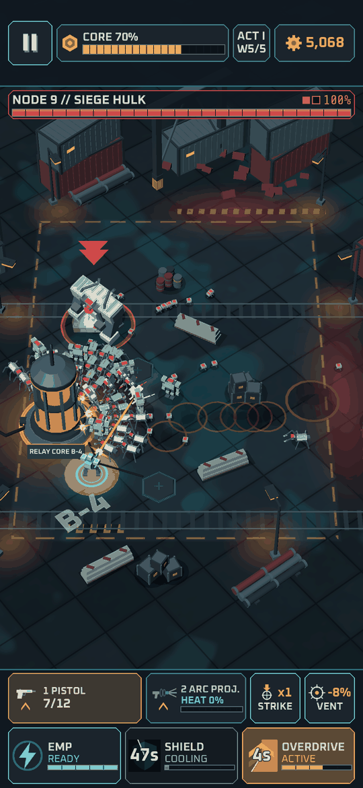 |  | 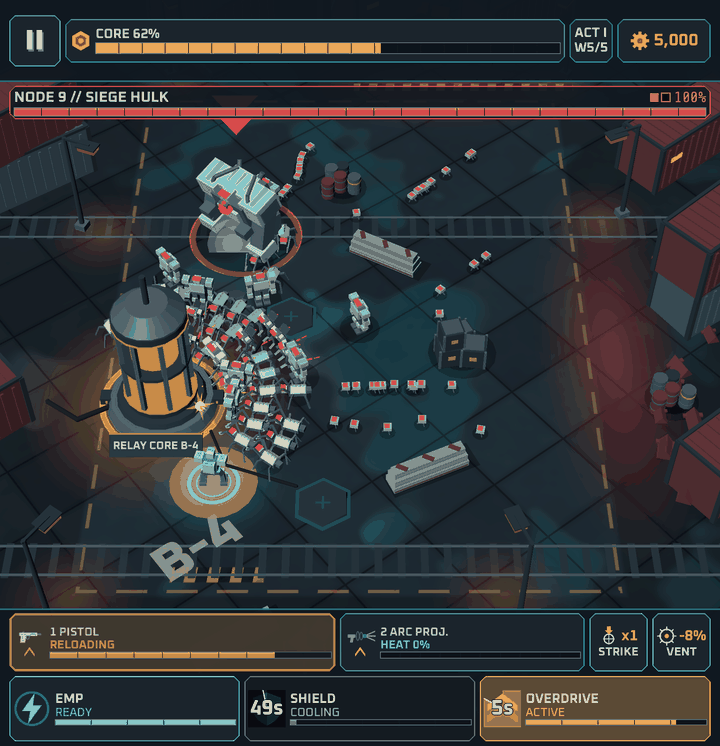 |
| The chain on LOW | on MID | on HIGH | The foldable's inner display |

**In the build today:**

- **The run:** 15 waves in three acts, bosses at waves 5, 10 and 15 (a Brood Carrier or a Lance Platform, an Aegis Array or a Tremor Rig, then the Siege Hulk in one of three variants). Between waves: salvage, a one-of-three directive draft (60 directives in six families), a route choice of two threats with a modifier and a reward, a boss briefing, a breather. A run takes about 13 to 17 minutes by design (the current build runs shorter: see [Status](#status)).
- **Combat:** ten weapons in seven firing kinds (two carried, swapped by tap, each with a level-3 perk), three turret types, three abilities (EMP, Shield, Overdrive) and three calls (Deadfall Strike, Freight, Vent), and a core you can patch between waves.
- **Enemies:** skitters, rushers and hollow Wardens, plus 8 newer types (motes in hundreds, bursters, spitters, splitters, shieldbearers, reclaimers, jammers, borers), 10 elite affixes, and up to 50 living bodies plus 40 minis at once.
- **Chaos:** 10 events, fuel drums, mines, route modifiers and 12 threat packs, all drawn from seeded streams.
- **Meta:** the Archive (24 unlocks and 13 milestones bought with Recovered Data), six starting kits, a Daily Run, a same-seed replay from the results screen, and resume after the app is killed (a snapshot at every wave clear).
- **Presentation:** a procedural look (meshes, materials and audio are generated in code; the icons are original SVGs), three quality tiers, Reduced Flash and High Contrast modes, touch targets of at least 132 px, and a guard test that fails when any screen leaves the viewport.
- **Under the hood:** a deterministic fixed-tick simulation (60 ticks per second) with named seeded random streams, so a seed replays exactly and the whole game runs headless for balance and soak tests.

## Status

The work is organised in waves ([work plan](docs/WORK_PLAN.md)). The **15-wave game is built and runs end to end** on the desktop (a bot can play a whole run headless). **Next is the balance pass**, then release QA on a real phone.

| Wave | Goal | Status |
|---|---|---|
| W0 to W4 | Contracts, sim, a 5-wave slice, look-dev, camera and environment | Done |
| V0 | The variety design: pitch, spec and content tables | Done |
| V1 to V3 | Contract scaffold, the sim systems, the playable 5-wave slice | Done |
| V4 | All the content: weapons, enemies, elites, bosses, events, directives, the Archive, audio and effects | Done |
| V5 | The 15-wave game integrated, every screen fitted, an accessibility audit and 50+ screenshots | Done |
| V5-C | Balance with the scorecard (values only) | Next |
| V6-Q | Release QA, including a real two-process resume check and phone measurements | Planned |

Measured with the scorecard on 30 seeds, before the balance pass: the `balanced` bot wins about half of its runs with the starting pool (16 of 30) and fewer with every unlock (7 of 30), and its winning runs last about 10 minutes against the 13 to 17 the design wants, so the balance pass is next. The last measurement on a phone (a Pixel 11 Pro Fold, before the V4 content) held 60 fps on the LOW tier and about 56 fps on MID and HIGH with 50 enemies; it has to be repeated on the new build ([`docs/reports/PHONE_PERF.md`](docs/reports/PHONE_PERF.md)). On the desktop the sim costs about 0.4 ms per tick.

## Quick start

Windows 11 with PowerShell, Godot 4.7.2 at `C:\dev\tools\godot\4.7.2\` (the pinned version is in `tools/GODOT_VERSION`) and Python 3.12 (`py -3.12`). For an APK you also need export templates, JDK 17 and the Android SDK: exact versions and install notes are in the [build instructions](docs/reports/BUILD_INSTRUCTIONS.md). Clone to a normal drive path such as `C:\dev\tower-two` (not `\\wsl$`); the tools work unchanged in a git worktree.

```powershell
.\tools\check.ps1                                     # import, compile (warnings are errors), layer lint, all tests -> "CHECK OK"
.\tools\test.ps1 -Path tests/unit/sim_plan            # one test folder or file
.\tools\sim_run.ps1 -Seed 1 -Policy balanced -Runs 20 # whole runs headless, a bot plays
.\tools\scorecard_run.ps1 -Runs 30 -Pool base -Jobs 4 # the predictability and balance scorecard
.\tools\capture.ps1 -Scene res://src/debug/view_sandbox.tscn -Out build\shots\view.png -Size 1080x2342
.\tools\deploy_android.ps1                            # export the debug APK, install it on the connected device, launch it
```

You can also open `project.godot` in Godot 4.7.2 and run it on the desktop. A debug build accepts flags after `--`, for example `--autoplay=balanced --seed=7` (a bot plays), `--scenario=boss:aegis_array` (start at a boss) or `--wave=10`; they are listed in [`CLAUDE.md`](CLAUDE.md) and the architecture notes.

## Documentation

| What | Where |
|---|---|
| Game rules, numbers, glossary | [`docs/GAME_DESIGN.md`](docs/GAME_DESIGN.md) |
| The variety design: pitch, spec, every id and number | [`docs/design/`](docs/design/VARIETY_SPEC.md) |
| Contracts, layers, the sim, the save and run files | [`docs/ARCHITECTURE.md`](docs/ARCHITECTURE.md) |
| Waves, task cards and acceptance | [`docs/WORK_PLAN.md`](docs/WORK_PLAN.md) |
| Evidence: tests, balance, phone performance, screenshots | [`docs/reports/`](docs/reports/) |
| The original handoff package (data baselines, references, QA plan) | [`docs/handoff/`](docs/handoff/) |
| Conventions for working with a coding agent | [`CLAUDE.md`](CLAUDE.md) |

## License

No license has been chosen yet, so all rights are reserved by default. Third-party components keep their own licenses: Oxanium and Share Tech Mono (SIL OFL 1.1, `assets/fonts/`), GdUnit4 (MIT, `addons/gdUnit4/`), and the other plugins under `addons/`.
